# ControlHeatPump 2.0 — «Народный контроллер» теплового насоса

Контроллер теплового насоса (Arduino Due, FreeRTOS) для отопления и ГВС: управление компрессором через
инвертор (Omron MX2, возможен Vacon), электронным расширительным вентилем (ЭРВ), насосами, бойлером и
ТЭНом, расписания, статистика, графики, уведомления, MQTT и «Народный мониторинг», выносной экран Nextion.

Этот проект — **развитие и глубокая переработка** прежнего проекта
[pav2000/ControlHeatPump](https://github.com/pav2000/ControlHeatPump) (последняя версия того проекта, от которой
шло развитие, — 1.098 и слияние веток в 2.01). Из прежнего проекта сохранены архитектура задач, принцип работы
алгоритмов, формат сохранения настроек (старые файлы `settings.bin` читаются) и железо. Всё остальное
упрощено, разобрано на модули и переписано; подробности — в конце.

## Что убрано

Проект сужен до одной рабочей конфигурации — тепловой насос «земля–вода» с инвертором Omron, ЭРВ и бойлером
ГВС. Удалены прочие готовые конфигурации (`CONFIG_1…4, 6, 7`, выбор в `Config.h` больше не нужен),
поддержка NTC-термисторов, радиодатчиков, нескольких шин 1-Wire, аналоговых датчиков на внешних АЦП и
электросчётчиков PZEM-004T и SDM630, а также малой микросхемы EEPROM 24C32. Из алгоритмов убраны солнечный
коллектор с регенерацией геоконтура, супербойлер, тёплый пол, второй насос входного контура, EVI, ваттроутер,
автозапуск генератора, альтернативная формула ПИД и корректировка мощности по реле.

Из веб-морды убраны jQuery, jQuery UI и Highstock (графики рисует собственный лёгкий `chart.js` на SVG),
отдельные мобильные страницы (мобильный вид теперь режим единой адаптивной морды) и прежний виджет погоды (вместо него — новый прогноз, см. ниже). Число
профилей сокращено с 10 до 5, расписаний — с 9 до 5; старые записи читаются с обрезкой. Режим «Охлаждение»
отключается опцией `ONLY_HEAT`.

Полный перечень (около 90 пунктов с названиями макросов и причинами) — в файле
[Doc/Удалённый-функционал.txt](Doc/Удалённый-функционал.txt).

## Что переделано и добавлено

**Код прошивки разобран на модули.** Вместо россыпи `.ino`-файлов остался один `Control.ino`, а логика лежит
в `Control/src` по каталогам `core`, `hw`, `log`, `net`, `util`. Ядро управления вынесено в `ClimateControl`,
расчёт перегрева ЭРВ — в `OverheatCalc`, расписания — в `SchedulerCalc`; всё это чистые функции, не зависящие
от железа. Сторожевой таймер заменён контролем отметок задач в точках блокировки; в журнал пишется, какая задача
зависла.

**Веб-API и веб-морда переписаны.** Старый протокол `/&get_X(P)&&` заменён реестром параметров и JSON;
аварийная страница работает на том же API и позволяет залить морду на SPI Flash или SD,
не пересобирая прошивку. Новая морда — разделы «Главная» (обзор и схема), «Климат» (отопление, ГВС, профили, расписание), «Графики» (онлайн, статистика, история), «Оборудование» (датчики, ЭРВ, инвертор, реле, прочее) и «Система» (сеть, время, уведомления, MQTT, файлы, диагностика); единый стиль, светлая и тёмная темы, компактная плотность, мобильный вид с нижней панелью навигации, подсказки у полей, кнопка «Справка» на каждой странице, две роли доступа (`user` видит только обзор, схему и «О контроллере», `admin` входит по логину и паролю), защита от потери
несохранённых правок, плашка «Нет связи с контроллером».

**Новое в алгоритмах и данных.** Режим ГВС «бойлер греет только ТЭН» и «длительная обработка сальмонеллы»;
на генераторе ТЭН бойлера всегда выключен, а ГВС от ТН продолжается; погодозависимость отопления с
отображением состояния; история на SD-карте (`hist2_ГГГГ.dat`) с детализацией включений компрессора;
исправлены восьмеричные значения по умолчанию (`050`, `070`), отправка почты приведена к RFC 5321/5322,
Формат настроек получил версию и
разбор, который не портит загрузку файлов, записанных версиями 1.098 и 2.x.

**Документация.** Руководство пользователя (PDF лежит в `Web/manual.pdf`) и справка внутри морды по каждой странице.

## Рабочая плата

Готовая плата pav2000 версии 2.1 (вид сверху и снизу):

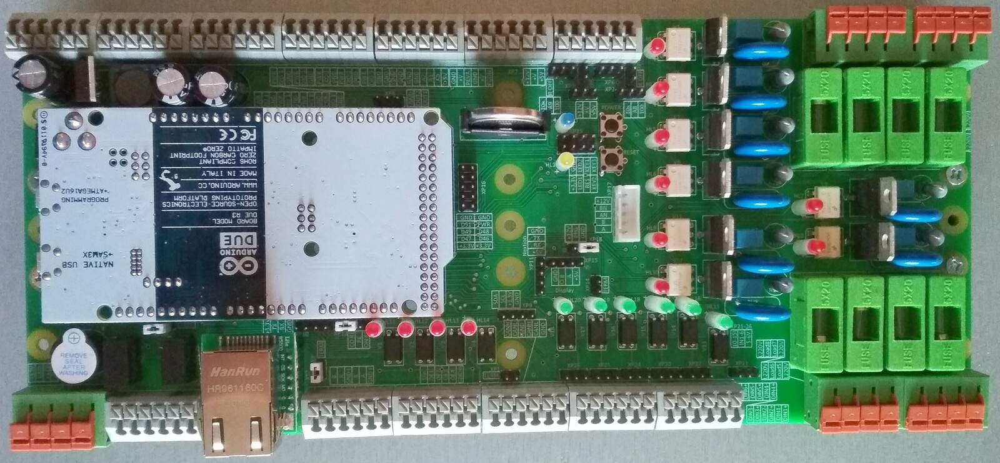
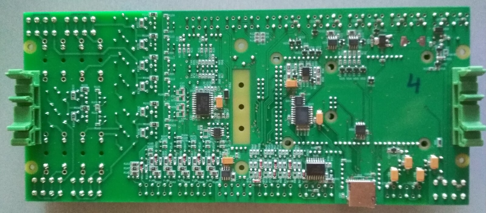

## Веб-интерфейс

Ниже — страницы новой морды. Слева постоянное меню: «Главная», «Климат»,
«Графики», «Оборудование», «Система», внизу — «О контроллере». Скриншоты шириной 1200 px показывают вид «монитор». В прежнем проекте это были страницы на
jQuery/Highstock с таблицами и отдельным набором мобильных страниц. Скриншоты сняты на стенде в режиме DEMO,
поэтому значения на графиках синтетические.

**Главная, «Обзор».** В одном окне: температура дома и цель с кнопками «−/+», бойлер ГВС (кольцо с
температурой, цель, значки работы ТН и ТЭН, «Срочный нагрев»), ключевые показатели ТН (частота компрессора,
перегрев, положение ЭРВ, мощность, COP), состояние контуров, график и события. По желанию включается прогноз погоды на 5 или 7 дней (источник Open-Meteo; запросы делает браузер, место и настройки хранятся только в нём; включается на странице «Оборудование → Прочее»). Раньше то же самое было
рассыпано по нескольким страницам и требовало открывать меню.

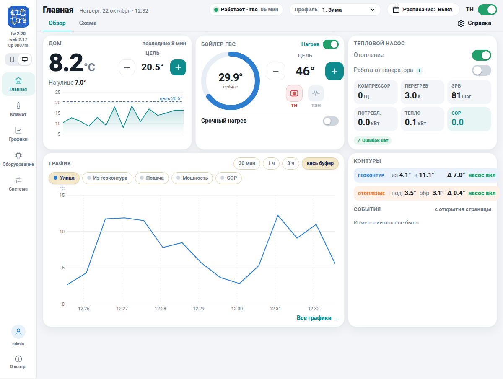

**Главная, «Схема».** Живая схема теплового насоса: геоконтур, испаритель, компрессор, конденсатор, бойлер и
отопление с температурами и расходом, состояние насосов, ЭРВ и реле. Схема собирается по настройкам, поэтому
узлы, которых нет в конфигурации (охлаждение, солнечный коллектор), на ней не рисуются.

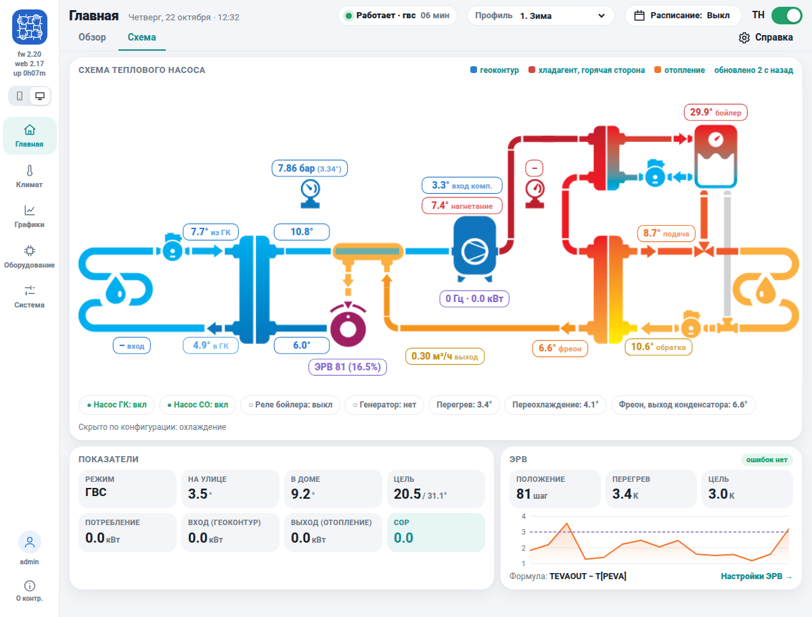

**Климат → Отопление.** Режим работы и алгоритм (гистерезис, ПИД или гибрид), цель — температура дома или обратки, гистерезис, в том числе при работе от генератора. Здесь же две погодозависимые поправки: сдвиг цели в доме по температуре на улице и кривая подачи для ПИД, каждая с графиком и строкой «сейчас». Отдельные карточки: ночной тариф, дополнительный ТЭН (контур отопления) и защиты при работе ТН (максимальная подача, минимальная обратка, разность на конденсаторе). Тонкая настройка ПИД сворачивается. Раньше эти настройки были таблицей параметров на одной длинной странице.

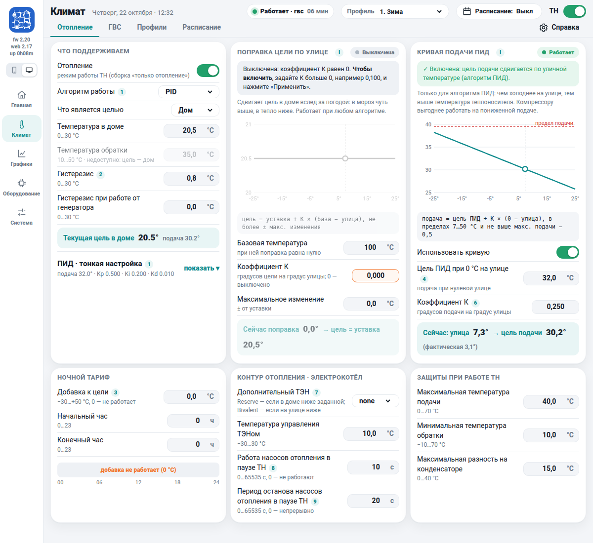

**Климат → ГВС.** Нагрев бойлера, «срочный нагрев», целевая температура и гистерезис, текущая температура в бойлере; ночной тариф; встроенный ТЭН (режим «бойлер греет только ТЭН», ускоренный нагрев, догрев и его температура); циркуляционный насос и сброс избыточного тепла; защиты и профилактика сальмонеллы, в том числе длительная обработка. Внизу — недельное расписание нагрева в виде сетки «день × час», которое рисуется протяжкой мышью или пальцем.

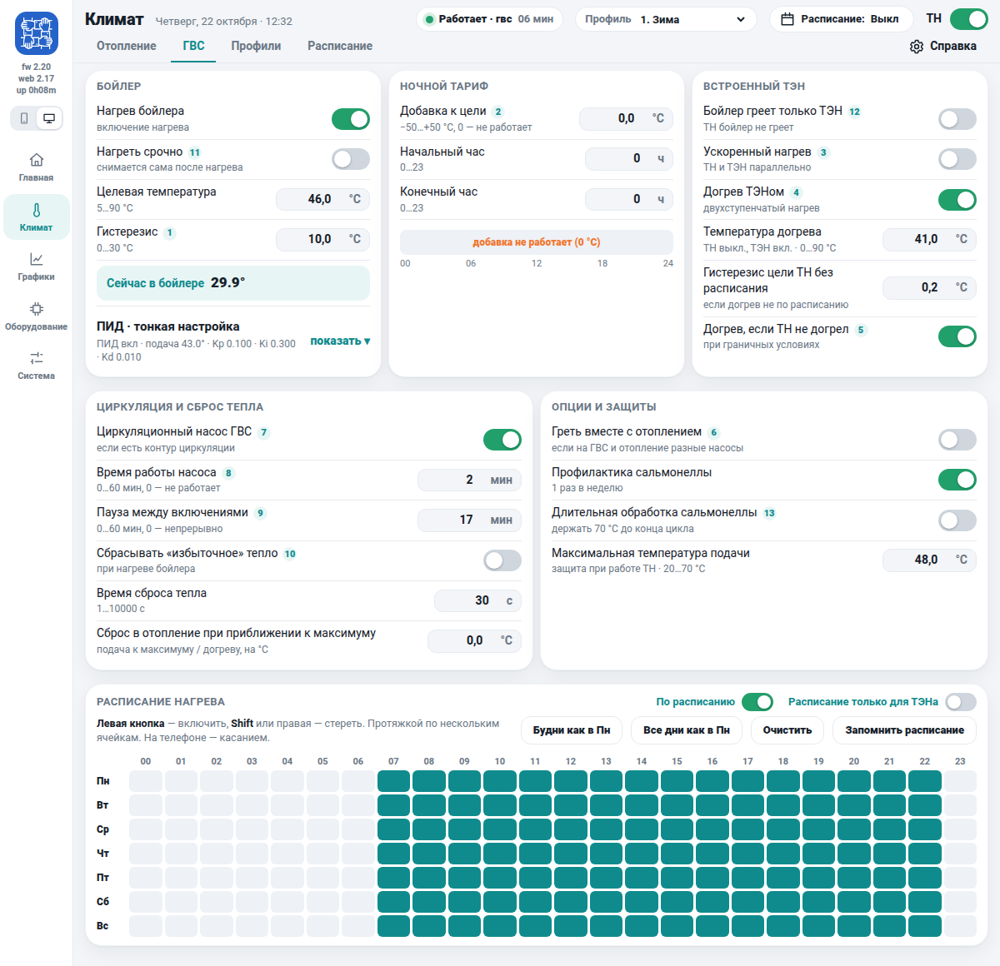

**Графики.** Вкладки «Онлайн», «Статистика» и «История». Выбор рядов по группам, масштаб протяжкой мышью,
навигатор по всему диапазону, подсказка со значениями всех рядов, экспорт. Прежде графики рисовала сторонняя
библиотека Highstock, теперь — собственный `chart.js` на SVG, он заметно легче и работает прямо из флеша
контроллера.

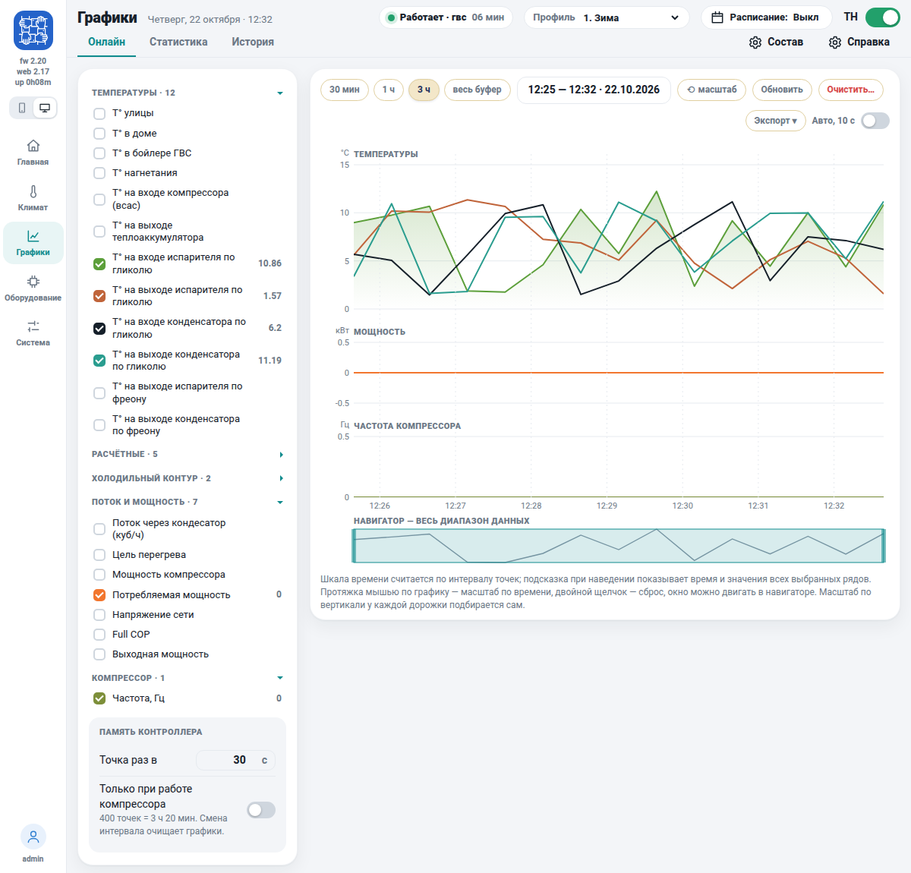

**Оборудование → ЭРВ.** Рабочие значения (положение, перегрев, температура кипения), график перегрева и
положения вентиля, ввод ПИД-коэффициентов с пояснениями, ручное задание положения с подтверждением,
переключение «ПИД / Прямое управление».

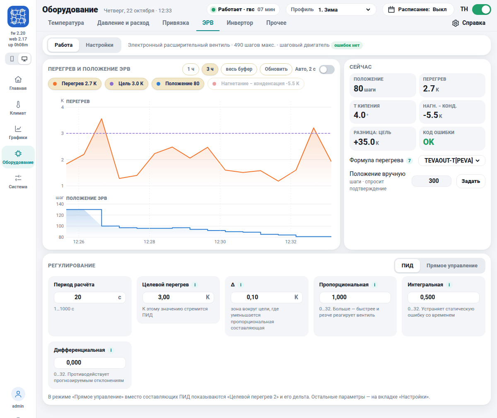

**Мобильная версия** (на скриншоте — начало страницы «Главная»). Включается автоматически при ширине окна меньше 760 пикселей: одна колонка и нижняя
панель «Главная / Схема / Графики / Настройки». В прежнем проекте для телефона были отдельные страницы со
своим меню и стилями.

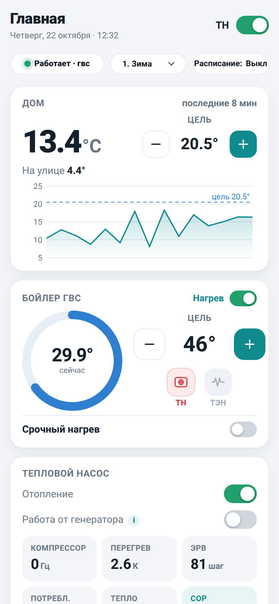

## Выносной экран Nextion

Поддержка дисплея Nextion сохранена: главная страница, схема и страница отопления. Описание и файлы
прошивки дисплея — в [прежнем репозитории](https://github.com/pav2000/ControlHeatPump/tree/master/Nextion).

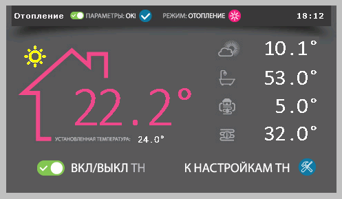
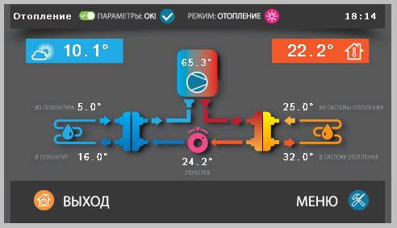
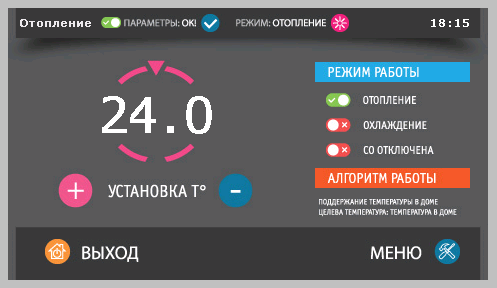

## Что изменилось по сравнению с прежним проектом

### Состав и сборка

* Одна конфигурация железа вместо семи; `Config.h` описывает только её. Остальное сохранено в истории git и в
  прежнем репозитории.
* `Control.ino` — единственный `.ino`; остальные файлы стали `.cpp/.h` в `Control/src/{core,hw,log,net,util}`.
  Строковые константы вынесены в общую таблицу (экономия 2072 байт флеша), общий заголовок `Constant.h`
  больше не размножает данные по единицам трансляции.
* Режимы сборки `DEMO` (демонстрация без железа) и `ONLY_HEAT` (без охлаждения). Отладочные макросы
  (`DEBUG`, `DEBUG_PID`, `NEXTION_DEBUG` и др.) заменены флагами `DebugFlags`, которые включаются на
  работающем контроллере без пересборки.

### Надёжность

* Сторожевой таймер: вместо сброса из idle-хука и разбросанных `WDT_Restart` — отметки живости задач в
  точках блокировки и отчёт, какая задача молчит и сколько запаса осталось. Перезагрузку по отказу задачи
  `UpdateEEV` разобрано и исправлено (вызов сна нарезан так, чтобы не снимать законную страховку).
* `assert()` пишет в журнал и ведёт к перезагрузке, а не теряется в stderr; при фатальном отказе ядра
  мигает светодиод, а не реле насоса (исправлен дефект старого кода).
* Чтение настроек больше не пишет в EEPROM при каждой загрузке; запись проверяется пачками по 64 байта.
* Отправка почты соответствует RFC 5321/5322: CRLF, EHLO с адресным литералом, выбор AUTH по ответу сервера,
  кодирование темы по RFC 2047, повторы при временных ошибках, защита от инъекции команд SMTP.
* Исправлены переполнения буферов, гонки за семафор сети и ошибки значений по умолчанию (восьмеричные
  константы).

### Веб

* Протокол: реестр параметров и JSON вместо строковых команд `get_X(P)`; ключи вида `heat.temp1`, `net.ip`.
* Библиотеки jQuery, jQuery UI, Highstock удалены; морда заметно легче, нет внешних зависимостей, работает
  без интернета.
* Единая адаптивная морда вместо десктопных и мобильных страниц; темы оформления и две плотности.
* Справка по каждой странице встроена в морду, руководство — в PDF (`Web/manual.pdf`).
* Аварийная страница для восстановления морды; источник морды (SPI Flash или SD) переключается без
  пересборки, флаг `SD_ONLY` не нужен.
* Графики стали настраиваемыми во время работы; добавлены история на SD с детализацией компрессора и
  посуточная статистика.

### Алгоритмы и функции

* ГВС: режим «греет только ТЭН», длительная обработка сальмонеллы, корректная работа на генераторе
  (ТН продолжает греть бойлер, ТЭН выключен).
* ЭРВ: расчёт перегрева вынесен в проверяемую функцию, равносильность старому коду доказана прогоном
  случайных входов; на графиках — цель, положение и разность «нагнетание –
  конденсация».
* Расписание и профили: 5 профилей и 5 календарей; погодозависимость цели; пересчёт расписаний вынесен в
  отдельный модуль.
* Уведомления: почта, SMS, MQTT, «Народный мониторинг» (отправка переделана после того, как отправка по MQTT
  стала платной), пинг, «Обновить IP» у серверов.
* Формат настроек: добавлена версия формата, старые файлы настроек читаются.

### Что не изменилось

* Железо: плата pav2000 v2.1 на Arduino Due, W5500, DS2482 с датчиками DS18B20, шаговый ЭРВ, Omron MX2 по
  Modbus RTU, Nextion.
* Основные алгоритмы работы ТН (ПИД частоты и ЭРВ, защиты, оттайка, учёт моточасов).
* Адреса веб-файлов состояния и файловая выдача (`state.txt`, `settings.bin`, `journal.txt`, `chart.csv`).

## Структура репозитория

| Путь | Содержимое |
|---|---|
| `Control/` | прошивка: `Control.ino` (точка входа), `Config.h` и `Config.cpp` (конфигурация и опции сборки), `Constant.h`, `README.md` (правила именования и комментариев); исходники в `src/`: `core/` (ядро: тепловой насос, профили, расписания, ПИД, сторожевой таймер, настройки), `hw/` (железо: датчики, ЭРВ, инверторы Omron и Vacon, Modbus, Nextion), `log/` (журнал, статистика, графики), `net/` (веб-сервер, веб-API, MQTT, почта и SMS, сеть), `util/` (время, вспомогательные функции) |
| `Web/` | веб-морда: страницы, `style.css`, `chart.js`, справка по страницам, PDF-документация; заливается на SPI Flash или SD-карту контроллера |
| `Libraries/` | библиотеки для сборки прошивки (большинство изменены), в том числе правленая `FreeRTOS_ARM` |
| `Hardware/` | файлы стандартного ядра Arduino SAM 1.6.12, которые надо заменить в SDK для Due (см. `Hardware/README.md`) |
| `Nextion/` | всё про выносной экран: прошивка дисплея (`nextion.tft`, проект `nextion.HMI`), вариант для 7 дюймов, документация, 3D-модель корпуса, фото (см. `Nextion/README.md`) |
| `WiFiSensor/` | необязательное оборудование: удалённый WiFi-датчик двух температур на ESP8266 с OLED-экраном и веб-страницей настройки (см. `WiFiSensor/README.md`) |
| `Doc/` | список функционала, удалённого из прежнего проекта |
| `Picture/` | картинки для этого файла |
| `LICENSE` | лицензия GNU GPL v3 |

## Обсуждение

Обсуждение проекта на форуме: <https://www.forumhouse.ru/threads/352693/>,
<https://www.forumhouse.ru/threads/437182/>, <https://www.forumhouse.ru/threads/492563/>.
Авторы прошивки — Pav2000 и vad711.
